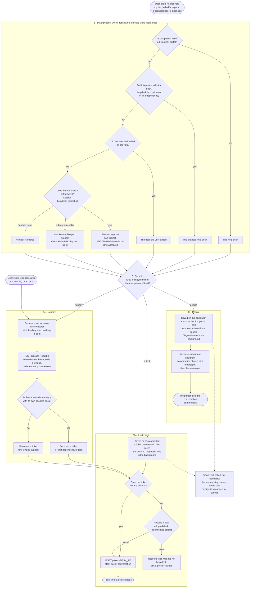

The real flow, not a design. Sources: `flow_sdk/app/actions/ask_for_help_action.py` (capture, `help-recipients`, `_open_ticket`, `_open_person_ask`, `_report_target`), `flow_sdk/app/actions/flow_message_action.py` (`resolve_helpdesk`, `_hub_default_helpdesk`), `flow_sdk/app/helpdesk_resolver.py`, `ui/src/components/help/AskForHelpDialog.tsx`, and the hub's `flowpad/config.py` (`HELPDESK_PROJECT_ID`).

The desk is the user's choice, not an automatic route: the dialog lists every desk they can ask, nearest first, and pre-checks the first one. Adding a person unchecks the desks. A desk and people together make two conversations: the people's conversation and the desk's own ticket. Every extra desk checked gets a ticket of its own.

