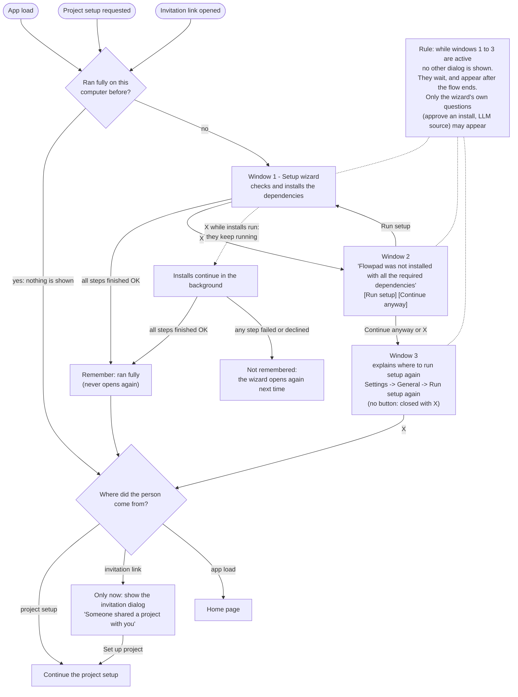

"Ran fully" means every step finished OK, on this computer. The wizard opens whenever it has not: on every app load and before every project setup.
An invitation to a project (a shared-project link) is a project setup that starts with a dialog: that dialog is NOT shown until everything in this chart has happened. A project setup always goes through the wizard first; when it already ran fully the person sees nothing of it, only the project setup they came for.
While windows 1 to 3 are on screen no other dialog is shown (the invitation, a project load, a source setup and so on): each waits and appears after the flow ends. Only the wizard's own questions (approve an install, choose an LLM source) may appear inside it.
Window 1 has X (Minimize appears after Start and does not leave the flow; a run that ended short also offers a Skip, which is the same as X); Continue anyway and X are the same in window 2. Window 3 has no button: X is the only way out, and for a project setup or an invitation it opens the gate for this session (a load waits on nothing, so leaving it opens nothing). Installs already started keep running in the background after X; if they all end OK, that counts as "ran fully".

