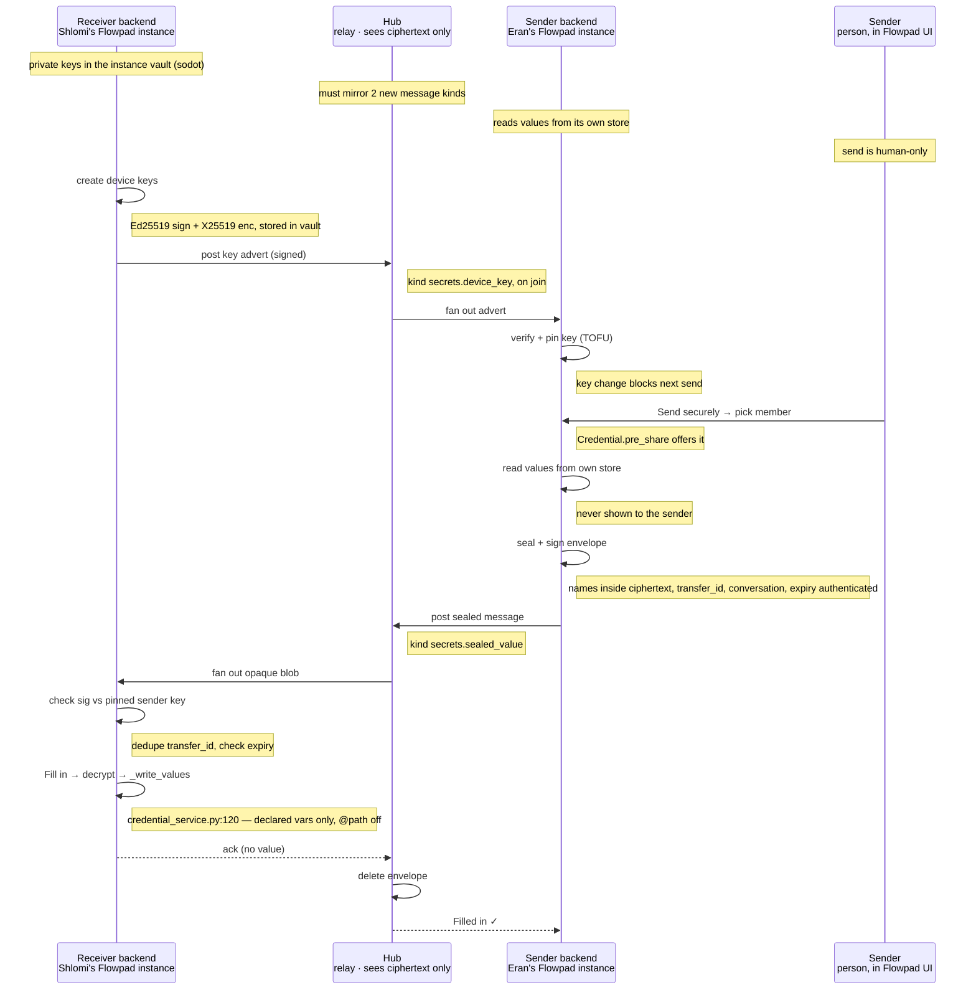

Design proposal (not built). The hub only relays opaque ciphertext; private keys stay in each instance's vault.

<!-- BEGIN chart:auto -->

_Auto-generated from chart.json — edits inside this block are overwritten on next save._
<!-- END chart:auto -->
