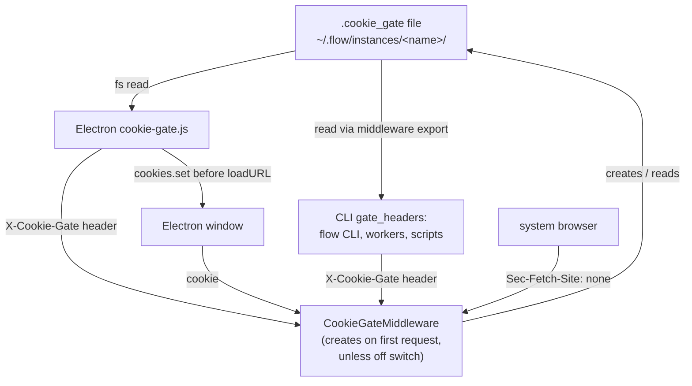
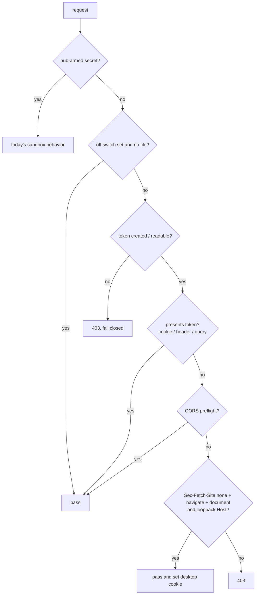

# Local Backend Cookie Gate - Plan

**Ticket:** FLOWPAD-2233 (CWE-306, Missing Authentication for Critical Function)

***

## Goal Capsule

* **Objective:** A page from another website the user visits can no longer drive their local Flowpad backend: the ticket's proof of concept (create a shell, then `run-detached`) gets refused. The desktop app, the `flow` CLI, and opening `localhost:9007` in a browser keep working.

* **Means:** the existing `CookieGateMiddleware` gains a per-install local token in a plain file and enforces it. That is the only backend change. Electron and the CLI read the same file and present it (KTD1, KTD10, KTD9).

* **Authority:** Product Contract Requirements win on behavior. KTDs win on mechanism. Units implement; they override neither.

* **Stop conditions:** stop and ask if any of the following happens:

  * a hub sandbox stops arming or logging in;

  * the Electron app can't pass its startup health check;

  * a backend change outside the middleware turns out to be unavoidable.

* **Execution profile:** the middleware module (`flow_sdk/server/middleware/`), the CLI transport and other callers, the Electron shell (`electron/`), test setup, and docs, in one repo on branch `FLOWPAD-2233`. One cross-repo dependency (hub images) is tracked in Risks & Dependencies.

***

## Product Contract

### Summary

The first time a local backend serves a request, its middleware creates a random token file. From then on it refuses any HTTP or WebSocket request that doesn't present that token, unless an explicit off switch is set. Electron reads the file and sets the cookie in its window and the header on its own requests. The CLI reads the file and sets the header. A browser gets the cookie when the user opens the app directly. Hub sandboxes keep working exactly as today.

### Problem Frame

The local backend on `localhost:9007` answers every request without authentication. The browser lets any web page send requests to it, and the CORS config whitelists the `null` origin with credentials. As a result, a page can create a shell through `POST /api/v1/graph/shell`, read its id, and run a command through `/run-detached` (the PoC in the FLOWPAD-2233 comments). This is the same class as MCP Inspector CVE-2025-49596.

`CookieGateMiddleware` already gates every request when a secret is set, but only hub sandboxes ever set one. On desktop it never arms.

### Key Decisions

* **Backend changes stay in the middleware.** Electron gets a reading utility that sets the cookie, and the CLI reads the token from its path and sets it on each request. (session-settled: user-directed — chosen over spreading the change across backend startup, the auth routes and the secret-store module.) Governs R1–R4, R6, R10.

* **The token is a plain file under flow home, not the encrypted store.** (session-settled: user-directed — chosen over the per-instance encrypted store (sod): Electron has no code to read the store, and reading it can fail open on desktop.) Governs R2.

* **The gate is on for every backend, with an explicit off switch.** (session-settled: user-directed — chosen over "desktop-managed backends only" and "everything except dev and tests": maximum coverage, with developers and tests opting out.) Governs R1, R3.

* **On Windows the token file relies on the user profile's inherited permissions.** (session-settled: user-directed — chosen over explicit `icacls` permission lists: every same-user process can read the keychain anyway, so the token only needs to stop web pages.) Governs R2.

* **Opening** **`localhost:<port>`** **directly in a browser works.** (session-settled: user-directed — chosen over a 403 for every direct open; the user proposed checking a browser-set header, refined to Fetch Metadata.) Governs R7.

* **The desktop cookie drops** **`Secure`** **and the** **`__Host-`** **prefix.** (session-settled: user-approved — chosen over keeping both: on loopback they add no protection and Safari drops such cookies on `http://localhost`.) Governs R8.

### Requirements

**Gate**

* R1. Every HTTP request and WebSocket handshake to a local backend is refused unless it presents the instance's token, except when the off switch is set or KTD5 or KTD7 lets the request through.

* R2. The token is a random per-install value in a plain file in the instance folder under flow home (`<flow_home>/instances/<instance>/.cookie_gate`). The backend creates it the first time it serves a request. Only the user can read it: 0600 on macOS and Linux, inherited profile permissions on Windows.

* R3. An explicit off switch turns the local gate off for the backend process; it is read once, at startup.

* R4. With the off switch unset, if the token can't be created or read, requests are refused (fail closed).

**Callers**

* R5. The CLI and every in-repo machine caller of the local backend present the token read from disk. No caller sends one instance's token to a different instance.

* R6. The Electron app works with the gate on: startup health check, main window, child windows and `flowpad://` deep links.

* R7. In a browser:

  * opening `http://localhost:<port>` or `http://127.0.0.1:<port>` directly (typed, bookmark, launched from the OS) works;

  * a request triggered by another site's page or link gets no cookie and is refused.

* R8. The desktop cookie is `HttpOnly`, `SameSite=Lax`, `Path=/`, kept for one year, and named per port so two local instances don't overwrite each other.

**Sandboxes**

* R10. Each request is checked by the gate for the way it came in. From the machine itself (a `localhost`/`127.0.0.1` Host): the local gate, on a desktop and a cloud box alike. From outside a hub-armed box (its public URL): the hub gate, unchanged. A non-loopback Host with no hub secret armed gets the local gate (it can only be DNS rebinding).

### Success Criteria

* Run against a desktop backend with the gate on, the ticket's PoC page gets 403 on its first request, and no shell is created.

* Electron launches, passes its health check and loads the app, on a fresh install and on an upgrade.

* `flow` CLI commands work unchanged against the running instance.

* The backend diff touches only the middleware module (plus tests and test setup).

### Scope Boundaries

* Removing `null` from CORS `allow_origins` and the postMessage bridge for sandboxed iframes are out of scope.

* A general `Host` allowlist (DNS-rebinding defense) is out of scope. The direct-open grant (KTD5) checks `Host` only for its own decision.

* Confirmation for deep links and SPA auto-run actions (`flowpad://…?action=launch`, CWE-939) is out of scope.

* The sandbox gate, its encrypted-store secret, `/auth/gate`, `login_callback` and `DesktopGateRefused` are not changed.

#### Deferred to Follow-Up Work

* Refuse any request carrying `Sec-Fetch-Site: cross-site`, even with a valid cookie (OWASP's second layer).

* Pages served on another `localhost` port (a shared artifact, a vibe app) and pages Flowpad serves on its own origin can still use the cookie and read API responses. Browsers treat every localhost port as the same site, and CORS accepts any localhost port with credentials. The fix is to refuse cookie-only requests marked `Sec-Fetch-Site: same-site` or `cross-site`, together with the item above.

* Browser login, OAuth and logout return paths into the gated backend (`/auth/login_callback`, `/auth/oauth/complete`, `/auth/oauth/callback`, `/api/v1/cloud/logout_callback`), and handling of cross-site redirects that set the cookie. Until this lands, those arrivals are refused like any other request without the token.

* CORS `null` removal and the iframe bridge (separate ticket).

* Deep-link confirmation for `action=launch` / `action=open` (CWE-939, separate ticket).

### Open Questions

* OQ2. **Blocking for release, not for implementation.** Hub-launched boxes must keep the local gate ON (no off switch), so their own browser is protected. Two hub-side changes: (1) the hub's loopback calls into a box (`/auth/login_callback` and anything else it curls to `127.0.0.1:9007`) send the box's local token, read in the same command (`-H "X-Cookie-Gate: $(cat <instance_dir>/.cookie_gate)"`) or made through the `flow` CLI; arming with `flow auth set-cookie-gate` is a CLI call and unaffected. (2) No shared image (E2B template, GCP VM image) may ship a `.cookie_gate`: each box creates its own on first request. Needs confirming and changing in `flowpad-hub`.

### Sources

* Ticket and RCA: FLOWPAD-2233 comments (PoC and root-cause analysis).

* GitHub Security Lab, "Localhost dangers: CORS and DNS rebinding" (2025): don't allow the `null` origin; authenticate sensitive endpoints; check `Host`.

* OWASP CSRF Prevention Cheat Sheet: Fetch Metadata (`Sec-Fetch-Site: none` for user-driven navigation; block when the header is missing) and `SameSite=Strict`.

* W3C Fetch Metadata spec / MDN: `Sec-Fetch-*` headers are browser-set and can't be forged by scripts.

* Jupyter Server security docs: token on by default, then a cookie.

* WebKit bug 231035: Safari rejects `Secure` cookies on `http://localhost`.

* Microsoft `CredRead` docs: Credential Manager access is per user, not per app.

***

## Planning Contract

### Key Technical Decisions

* KTD1. **The middleware module owns the local token.** It holds:

  * the file path (`<instance_dir>/.cookie_gate`);

  * create-if-absent on the first request, with exclusive create and 0600 on posix;

  * a read cached by file modification time;

  * the off switch.

  It exports one read function. The CLI's `gate_headers` imports it, the same way it already imports `HEADER_NAME` from this module. No other backend module changes. Implements the "backend changes stay in the middleware" Key Decision. Governs R1–R3.

* KTD2. **The off switch is** **`FLOWPAD_COOKIE_GATE=off`, read by the middleware.** It is read once, when the local gate is constructed, and turns that gate off for the process. Governs R3.

* KTD3. **Fail closed.** With the off switch unset, a token that can't be created or read means 403, never a pass. Governs R4.

* KTD4. **The desktop cookie** is named `cookie-gate-<port>` and set `HttpOnly`, `SameSite=Lax` (Strict refused the cross-site OAuth/login return navigations), `Path=/`, `Max-Age` of one year, without `Secure`. The middleware accepts it next to the existing sandbox cookie name. Governs R8.

* KTD5. **Direct-open grant.** A request without the token passes, and gets the KTD4 cookie set on its response, only when all of these hold:

  * `Sec-Fetch-Site: none`, `Sec-Fetch-Mode: navigate`, `Sec-Fetch-Dest: document`;

  * the `Host` hostname is `localhost` or `127.0.0.1` (a DNS-rebound name fails here; checking the port adds nothing);

  * no hub-armed secret is in force.

  Curl and the hub send no `Sec-Fetch-*` headers, so they never match. Governs R7.

* KTD7. **CORS preflights pass through to** **`CORSMiddleware`.** These are `OPTIONS` requests carrying `Origin` and `Access-Control-Request-Method`. Browsers never attach cookies to them and no route handler runs. The actual request that follows is still gated. Governs R1.

* KTD9. **Callers send this instance's token.** `gate_headers(url)` sends the local token of the caller's own instance to any loopback URL. (session-settled: user-directed — chosen over resolving each port to its instance through `server.json`: an end user runs one Flowpad, and dev setups that run several turn the gate off.) Governs R5.

* KTD10. **Electron reading utility.** A new `electron/cookie-gate.js`:

  * reads `~/.flow/instances/<FLOW_INSTANCE>/.cookie_gate`;

  * provides the `X-Cookie-Gate` header for main-process `fetch` calls;

  * provides the KTD4 cookie details, which Electron sets with `session.defaultSession.cookies.set` before each `loadURL`.

  Governs R6.

* KTD11. **The test suite defaults to the off switch.** `tests/pytest_plugin.py` sets it for the session, and gate tests opt in through a fixture. Without this, the first request in each in-process test app would create a token and later API tests would get 403s. Governs R3.

* KTD13. **Release order: Electron first, then the engine.** The Electron release with U6 ships before the engine release that turns the gate on. The new Electron works against an old engine (no token file, so no header and no cookie). (session-settled: user-directed — chosen over letting `/health/status` through the gate or gating only when Electron advertises support.) Governs R1, R6.

* KTD14. **Route by the way in.** `CookieGateMiddleware` sends a request to the hub gate only when a hub secret is armed and the Host is not loopback; everything else goes to the local gate. `gate_headers` therefore sends only the local token: its callers are all on the machine. (session-settled: user-directed — chosen over "hub secret replaces the local gate when armed": a cloud box's own browser is as much a target as a desktop's.) Governs R5, R10.

### High-Level Technical Design

Who reads the token:

The middleware's decision for each request:

### Assumptions

* Electron always reads `~/.flow`. It already ignores `FLOW_HOME` for its logs path, so a backend run with a custom `FLOW_HOME` under Electron stays unsupported.

* Electron's health check may start before the first request has created the token. It re-reads the file on each probe, so the first probe can get a 403 and the next one passes.

### Sequencing

U2 and U3 first, as one middleware change. Then U5, U6 and U8 independently. U7 last. U1 and U4 were folded into U2 and U3.

***

## Implementation Units

### U2. Local token in the middleware

**Goal:** The middleware creates, reads and enforces the local token, with the off switch and fail-closed behavior.

**Requirements:** R1–R4, R10. KTD1, KTD2, KTD3, KTD11, KTD14.

**Dependencies:** none.

**Files:**

* `flow_sdk/server/middleware/cookie_gate_middleware.py`

* `tests/pytest_plugin.py`

* `tests/unit/test_cookie_gate_local_token.py` (new)

**Approach:**

1. Add the token path, create-if-absent and cached read inside the middleware module. Get the instance directory from `get_instance_settings()`, as the module already does through `get_cookie_gate`.
2. `CookieGateMiddleware` routes each request (KTD14): hub gate for outside requests to an armed box, local gate otherwise. The local gate creates its token if absent and enforces it, unless the off switch was set at startup.
3. Export the read function for the CLI.
4. Have the pytest plugin set the off switch for the session, and add an opt-in fixture that turns it off and points at a temporary token.

**Patterns to follow:** the existing mtime cache in `flow_sdk/instance_settings/cookie_gate.py`; the 0600 plus `os.replace` write in `flow_sdk/builtin/credential_files.py`.

**Execution note:** land the pytest-plugin switch in the same commit, or the suite goes red.

**Test scenarios:**

* First request with no file creates a random token (at least 32 bytes of entropy) at the instance path. On posix the file mode is 0600.

* A second request and a backend restart keep the same token.

* Two concurrent first requests produce exactly one token.

* With the off switch set and no file, requests pass and no file is created.

* With the off switch set and an existing file, the token is enforced.

* If the file can't be created (read-only directory), the request gets 403 and the failure is logged.

* With the file deleted while running and the off switch unset, the next request recreates the token and the old cookie no longer passes.

* With a hub-armed secret in force, the local token is neither created nor accepted, and today's sandbox behavior holds.

**Verification:** the new tests pass. The full suite stays green with the plugin default. The backend diff, excluding tests, touches only the middleware module.

### U3. Middleware request decisions

**Goal:** The middleware lets through requests carrying the token, CORS preflights and direct browser opens, and sets the desktop cookie on direct opens.

**Requirements:** R1, R7, R8. KTD4, KTD5, KTD7.

**Dependencies:** U2.

**Files:**

* `flow_sdk/server/middleware/cookie_gate_middleware.py`

* `tests/unit/test_cookie_gate_middleware.py`

* `tests/api/test_cookie_gate.py`

* `tests/api/test_cookie_gate_ws.py`

**Approach:**

1. Keep the pure-ASGI shape and its place in the middleware order. Add the decision steps in the order of the HTD flowchart.
2. For the direct-open grant, wrap `send` so the KTD4 `Set-Cookie` is added to the passed-through response.
3. Accept `cookie-gate-<port>` alongside the existing cookie, header and query transports.
4. Rewrite the 403 page copy for local backends to explain how to get in ("Open Flowpad from its icon, or open this address directly in your browser"). Keep it inline, since static assets are gated.

**Test scenarios:**

* Covers the ticket PoC: `POST /api/v1/graph/shell` with `Origin: null` and no token gets 403, and no shell row is created.

* The `X-Cookie-Gate` header, the `cookie-gate-<port>` cookie, and the `?cookie-gate=` query each pass.

* `GET /` with `Sec-Fetch-Site: none`, `Sec-Fetch-Mode: navigate`, `Sec-Fetch-Dest: document` and `Host: localhost:<port>` passes and sets `cookie-gate-<port>` with `HttpOnly`, `SameSite=Lax`, a one-year `Max-Age` and no `Secure`.

* The same with `Host: 127.0.0.1:<port>` passes.

* The grant is refused in each of these cases:

  * `Sec-Fetch-Site: cross-site`;

  * `Sec-Fetch-Site: none` but `Sec-Fetch-Dest: iframe`;

  * a missing `Sec-Fetch-*` header;

  * `Host: evil.example:<port>`;

  * a hub-armed secret in force.

* An `OPTIONS` preflight with `Origin` and `Access-Control-Request-Method` reaches CORS. A bare `OPTIONS` gets 403.

* A WebSocket handshake without the token closes with 1008. With the cookie it connects.

**Verification:** the gate test files pass. The ticket's PoC HTML, run against a local backend, shows 403 in the browser console.

### U5. CLI and other callers

**Goal:** The CLI and every in-repo Python caller read the token from its path and set it on the request.

**Requirements:** R5, R7. KTD9.

**Dependencies:** U2.

**Files:**

* `flow_sdk/instance_settings/cookie_gate.py` (`gate_headers`: read the local token through the middleware export, per target port)

* `flow_sdk/cli/flow_cli.py` (`flow start` opens `http://localhost:<port>` instead of `127.0.0.1`, which the direct-open grant covers)

* `flow_sdk/core/compute_op/ask_window.py` (same change)

* `flow_sdk/graph_workflow_manager/function_runner.py` and `service_graph_workflows.py` (context calls use `gate_headers`)

* `flow_sdk/cloud_client/webhook_relay.py`

* `flow_sdk/discovery/flowpad_discovery.py`

* `tests/unit/test_cli_gate_transport.py`

* `tests/unit/test_webhook_relay_gate.py` (new)

* `tests/unit/test_function_runner_gate.py` (new)

**Approach:**

1. `gate_headers` sends the hub-armed secret when one exists, and otherwise the target instance's local token (KTD9). `local_request` and every caller already built on it need no change.
2. The function runner and its demo script send their requests through `gate_headers`.
3. The webhook relay attaches this app's token to the replay and drops any inbound `cookie` or `x-cookie-gate` header. (The replayed path is not restricted: the user chose not to guard a path the hub may not let senders control.)
4. Discovery and hook-report fan-out use the per-port lookup.

**Patterns to follow:** `local_request` in `flow_sdk/cli/commands/_common.py`.

**Test scenarios:**

* `gate_headers` for this instance's port returns its local token. For another running instance's port it returns that instance's token. For an unknown loopback port or a non-loopback host it returns nothing.

* With a hub-armed secret, `gate_headers` returns that secret.

* `flow start` opens a `localhost` URL with no token in it.

* The function-runner context `post` includes `X-Cookie-Gate`.

* The webhook relay attaches this app's `X-Cookie-Gate` and strips an inbound `cookie` / `x-cookie-gate`.

**Verification:** every caller the research marked as not sending the token has a test, or goes through `local_request`.

### U6. Electron

**Goal:** Electron reads the token, sets the cookie in its window and sends the header on its own requests.

**Requirements:** R6. KTD4, KTD10, KTD13.

**Dependencies:** U2 (behavior only; Electron ships first per KTD13).

**Files:**

* `electron/cookie-gate.js` (new)

* `electron/cookie-gate.test.js` (new)

* `electron/main.js`

* `electron/uv-manager.js`

* `electron/package.json` (append the new test to `"test"`)

**Approach:**

1. `cookie-gate.js` exports: the token path for an instance, a read that returns `null` when the file is absent, the header object, and the cookie details for a port.
2. The health poll re-reads the token on each probe and sends the header when present.
3. Before every `loadURL` (startup, deep links, the `uv-manager` loads), await `cookies.set` with the cookie details when a token exists. Child `/win/` windows share the default session.
4. The token never appears in logs.

**Patterns to follow:** `electron/backend-wait.js` with `backend-wait.test.js` (a pure module plus a `node` assert script); `electron/log-redact.js`.

**Test scenarios:**

* The token path honors `FLOW_INSTANCE` and defaults to `prod`.

* A missing file → `null` header and no throw. Once the file appears, the next read returns the token.

* Cookie details for port 9007: name `cookie-gate-9007`, `httpOnly: true`, `sameSite: 'lax'`, `secure: false`, path `/`, about one year until expiry.

* The probe sends `X-Cookie-Gate` when a token exists and nothing when it doesn't.

**Execution note:** after the unit tests, smoke-test a real Electron launch against both the new engine (fresh install, no token yet; and an upgrade) and the old engine. Also open a `flowpad://` deep link.

**Verification:** `npm test` in `electron/` passes. The manual launch reaches the app window with no 403 in the backend log.

### U7. Docs and developer setup

**Goal:** The docs describe the new behavior, and developers know how to set the off switch.

**Requirements:** R1, R3.

**Dependencies:** U2, U3, U5, U6, U8.

**Files:**

* `docs/cookie-gate.md`

* `docs/dev_setup.md`

* `docs/index.md`

* `scripts/instance_ctl.sh`

* `docker/docker-compose.yml` (set `FLOWPAD_COOKIE_GATE: "off"` in the shared backend env, which keeps the healthchecks and `docker/run_realtime_tests.sh` working)

**Approach:**

1. Add a "local token" section to `docs/cookie-gate.md`: on by default, the off switch, fail closed, the direct-open grant and the preflight pass, and how a hub-armed secret takes precedence. Update its "unset on every desktop install" statements.
2. Document `FLOWPAD_COOKIE_GATE=off` in the dev setup docs, and set it in repo-owned dev launchers.

**Test expectation:** none -- docs and dev-script config only.

**Verification:** the doc no longer contradicts the code. A named dev instance started through `scripts/instance_ctl.sh` serves the Vite frontend without 403s.

### U8. Shell scripts and shipped assistant instructions

**Goal:** Non-Python callers that `curl` the local backend present the token, so R5 holds beyond Python.

**Requirements:** R5.

**Dependencies:** U2.

**Files:**

* `scripts/validate_install.sh` (the PyPI release self-check)

* `scripts/ci_e2e_reset_backend.sh`

* `scripts/docker_install_snippet/in_container.sh`

* `flow_sdk/system_projects/flowpad_assistant/.claude/skills/flowpad-assistance/message.md`

* `flow_sdk/system_projects/flowpad_assistant/.claude/skills/flowpad-assistance/search.md`

* `flow_sdk/system_projects/flowpad_assistant/.claude/agents/asset-cleanup-wizard.md`

* `flow_sdk/system_projects/flowpad_assistant/.claude/skills/flow-diagnose/SKILL.md` and its `references/catalog.md`

* `tests/unit/test_no_bare_local_curl.py` (new)

**Approach:**

1. Sweep `scripts/` and `flow_sdk/system_projects/` for `curl` or HTTP calls to `localhost`, `127.0.0.1` or the backend port. The list above is what review found, not a closed set.
2. Switch each to the matching `flow` CLI command where one exists, since the CLI already sends the token. Otherwise send `-H "X-Cookie-Gate: $(cat <instance_dir>/.cookie_gate)"`.
3. flow-diagnose's liveness check treats a 403 from the gate as "up and gated", not "down".

**Test scenarios:**

* A repo scan finds no `curl` to a loopback backend URL in `scripts/` or `flow_sdk/system_projects/` that neither sends the gate header nor goes through `flow`.

* `scripts/validate_install.sh` passes against a freshly installed, gated backend.

**Verification:** the scan test passes. flow-diagnose reports a healthy gated backend as healthy.

***

## Risks & Dependencies

| Risk                                                                                                                 | Mitigation                                                                                                                         |
| -------------------------------------------------------------------------------------------------------------------- | ---------------------------------------------------------------------------------------------------------------------------------- |
| The hub's loopback calls into a box lack the box's local token and are refused (OQ2). | The hub sends the local token on loopback calls (or uses the `flow` CLI). Release is blocked until `flowpad-hub` confirms it. |
| An updated engine under an old Electron fails its health check and is killed after 120 s.                            | Release order (KTD13): the Electron release with U6 ships first.                                                                   |
| A local caller is missed and starts getting 403s.                                                                    | U5, U6 and U8 work from the research's caller list, and U8 adds a repo scan. The middleware logs every refusal with type and path. |
| Browser login, OAuth and logout returns into a gated desktop backend are refused until the deferred follow-up lands. | Known gap, tracked under Deferred to Follow-Up Work. Electron's `flowpad://` path carries the injected cookie and is unaffected.   |
| Users upgrading with an open browser tab get 403 until they reload.                                                  | The direct-open grant re-issues the cookie on the next typed or bookmarked load, and the 403 page says how to get back in.         |
| Links opened from other desktop apps may arrive with `Sec-Fetch-Site: none` (unverified) and get the cookie.         | Accepted: the same exposure `flowpad://` deep links have today, tracked in the deferred CWE-939 work.                              |

***

## Verification Contract

| Gate                   | Command / check                                                                                                                                                                                                                                                                                                                                              |
| ---------------------- | ------------------------------------------------------------------------------------------------------------------------------------------------------------------------------------------------------------------------------------------------------------------------------------------------------------------------------------------------------------ |
| Python unit and API    | `uv run pytest tests/unit/test_cookie_gate_local_token.py tests/unit/test_cookie_gate_middleware.py tests/unit/test_cli_gate_transport.py tests/unit/test_webhook_relay_gate.py tests/unit/test_function_runner_gate.py tests/unit/test_no_bare_local_curl.py tests/api/test_cookie_gate.py tests/api/test_cookie_gate_ws.py tests/unit/test_cookie_gate.py` |
| Full suite stays green | `uv run pytest` (in the background, per repo practice; never raise timeouts)                                                                                                                                                                                                                                                                                 |
| Electron               | `npm test` in `electron/`                                                                                                                                                                                                                                                                                                                                    |
| PoC regression         | Open the ticket's PoC HTML in Chrome against a local gated backend: the first `fetch` gets 403 and no shell is created.                                                                                                                                                                                                                                      |
| Desktop smoke          | New Electron with the new engine (fresh install and upgrade) and with the old engine; open a `flowpad://` deep link; run `flow status`; open `http://localhost:9007` in Chrome and Safari (the latter on macOS).                                                                                                                                             |

***

## Definition of Done

* R1–R8 and R10 are met and covered by the tests above.

* The backend diff, excluding tests and test setup, is confined to `flow_sdk/server/middleware/cookie_gate_middleware.py`.

* OQ2 is confirmed with `flowpad-hub` before release, and the Electron release with U6 ships before the engine release (KTD13).

* `docs/cookie-gate.md` matches the shipped behavior.

* No code from abandoned approaches is left in the diff.

