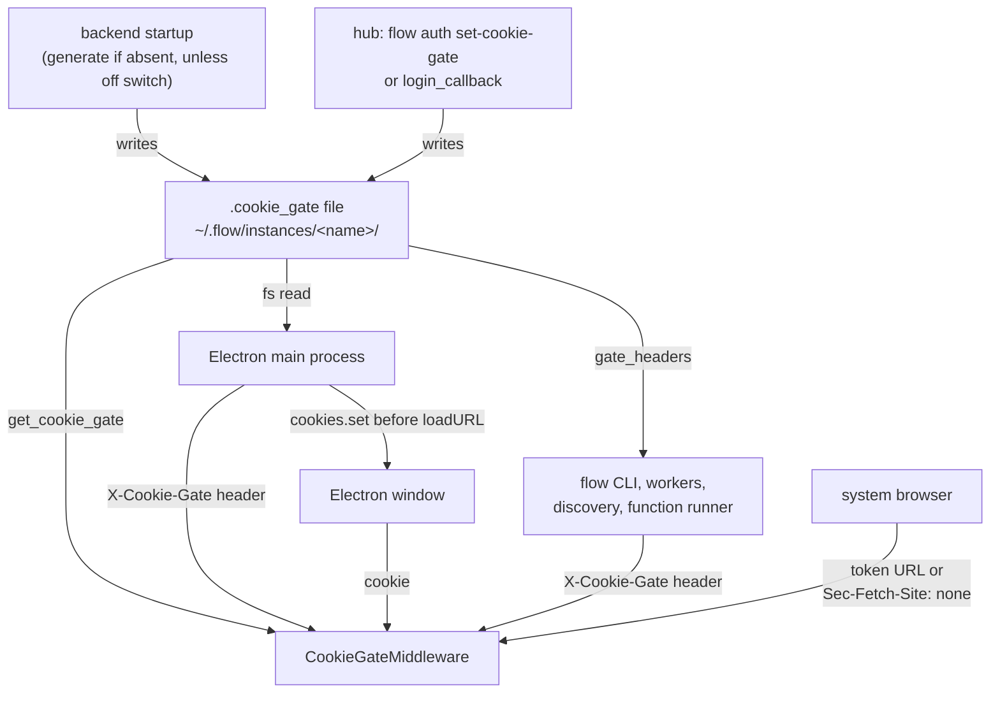
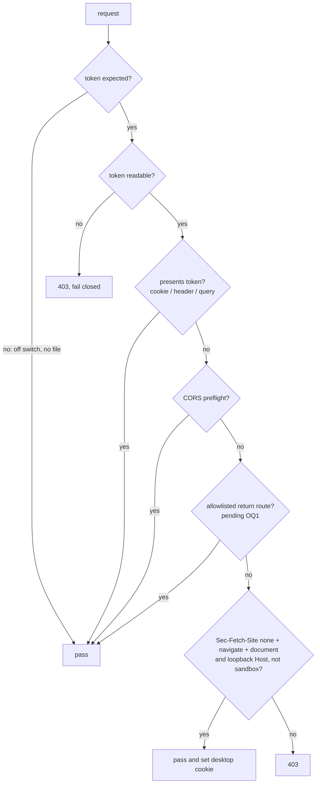

# Local Backend Cookie Gate - Plan

**Ticket:** FLOWPAD-2233 (CWE-306, Missing Authentication for Critical Function)

***

## Goal Capsule

* **Objective:** A web page the user visits can no longer drive their local Flowpad backend: the ticket's proof of concept (create a shell, then `run-detached`) gets refused. The desktop app, the `flow` CLI, and opening `localhost:9007` in a browser keep working.

* **Means:** turn on the existing `CookieGateMiddleware` for every local backend, backed by a per-install token in a plain file (KTD1, KTD2).

* **Authority:** Product Contract Requirements win on behavior. KTDs win on mechanism. Units implement; they override neither.

* **Stop conditions:** stop and ask if any of the following happens:

  * a hub sandbox stops arming or logging in;

  * the Electron app can't pass its startup health check;

  * an Open Question marked blocking is reached while still unanswered.

* **Execution profile:** Python backend and CLI (`flow_sdk/`), Electron shell (`electron/`), and docs, in one repo on branch `FLOWPAD-2233`. One cross-repo dependency (the sandbox template) is tracked in Risks & Dependencies.

***

## Product Contract

### Summary

Every local backend generates a random token at first startup and refuses any HTTP or WebSocket request that doesn't present it, unless an explicit off switch is set. The CLI and Electron read the token from disk. Browsers get it as a cookie, either from a token URL or from a navigation the user started themselves. Hub sandboxes keep their current arming flow and share the same storage.

### Problem Frame

The local backend on `localhost:9007` answers every request without authentication. The browser lets any web page send requests to it, and the CORS config whitelists the `null` origin with credentials. As a result, a page can create a shell through `POST /api/v1/graph/shell`, read its id, and run a command through `/run-detached` (the PoC in the FLOWPAD-2233 comments). This is the same class as MCP Inspector CVE-2025-49596.

The authentication mechanism already exists. `CookieGateMiddleware` gates everything when a secret is set, but only hub sandboxes ever set one. On desktop it is inert by design: the secret lives in the encrypted store behind a marker file, and `set_cookie_gate` refuses desktop outright (`DesktopGateRefused`).

### Key Decisions

* **The token is a plain file under flow home, not the encrypted store.** (session-settled: user-directed — chosen over the per-instance encrypted store (sod): Electron has no code to read the store, and reading it can fail open on desktop.) Governs R2.

* **The gate is on for every backend, with an explicit off switch.** (session-settled: user-directed — chosen over "desktop-managed backends only" and "everything except dev and tests": maximum coverage, with developers and tests opting out.) Governs R1, R3.

* **On Windows the token file relies on the user profile's inherited permissions.** (session-settled: user-directed — chosen over explicit `icacls` permission lists: every same-user process can read the keychain anyway, so the token only needs to stop web pages.) Governs R2.

* **Opening** **`localhost:<port>`** **directly in a browser works.** (session-settled: user-directed — chosen over a 403 for every direct open; the user proposed checking a browser-set header, refined to Fetch Metadata.) Governs R7.

* **The desktop cookie drops** **`Secure`** **and the** **`__Host-`** **prefix.** (session-settled: user-approved — chosen over keeping both: on loopback they add no protection and Safari drops such cookies on `http://localhost`.) Governs R8.

### Requirements

**Gate**

* R1. Every HTTP request and WebSocket handshake to a local backend is refused unless it presents the instance's token. This holds unless the off switch is set or KTD5/KTD8 lets the request through.

* R2. The token is a random per-install value in a plain file in the instance folder under flow home (`<flow_home>/instances/<instance>/.cookie_gate`), created at first startup. Only the user can read it: 0600 on macOS and Linux, inherited profile permissions on Windows.

* R3. An explicit off switch disables generating the token at startup. A token that has already been written (for example, by the hub arming a sandbox) is still enforced.

* R4. If the gate is expected to be on and the token can't be read, requests are refused (fail closed).

**Callers**

* R5. The CLI and every in-repo machine caller of the local backend present the token read from disk. No caller sends one instance's token to a different instance.

* R6. The Electron app works with the gate on: startup health check, main window, child windows and `flowpad://` deep links.

* R7. In a browser:

  * opening `http://localhost:<port>` or `http://127.0.0.1:<port>` directly (typed, bookmark, launched from the OS) works;

  * a token URL works;

  * a request triggered by another site's page or link gets no cookie and is refused.

* R8. The desktop cookie is `HttpOnly`, `SameSite=Strict`, `Path=/`, kept for one year, and named per port so two local instances don't overwrite each other. The sandbox cookie keeps its current attributes.

* R9. Browser login, OAuth and logout return paths into the local backend keep completing. (Mechanism pending OQ1.)

**Sandboxes**

* R10. Hub sandboxes keep the current arming contract (`flow auth set-cookie-gate` and `login_callback`'s `cookie-gate` parameter) and read the same token file as desktop.

### Success Criteria

* Run against a desktop backend with the gate on, the ticket's PoC page gets 403 on its first request, and no shell is created.

* Electron launches, passes its health check and loads the app, on a fresh install and on an upgrade.

* `flow` CLI commands work unchanged against the running instance.

### Scope Boundaries

* Removing `null` from CORS `allow_origins` and the postMessage bridge for sandboxed iframes are out of scope.

* A general `Host` allowlist (DNS-rebinding defense) is out of scope. The direct-open grant (KTD5) checks `Host` only for its own decision.

* Confirmation for deep links and SPA auto-run actions (`flowpad://…?action=launch`, CWE-939) is out of scope.

#### Deferred to Follow-Up Work

* Refuse any request carrying `Sec-Fetch-Site: cross-site`, even with a valid cookie (OWASP's second layer). Take it up after this core fix lands.

* CORS `null` removal and the iframe bridge (separate ticket).

* Deep-link confirmation for `action=launch` / `action=open` (CWE-939, separate ticket).

### Open Questions

* OQ1. **Blocking for the callback part of U3.** Should these routes be allowed through the gate when they arrive with no token?

  * `/auth/login_callback`, `/auth/oauth/complete`, `/auth/oauth/callback`, `/api/v1/cloud/logout_callback`.

  - Recommendation: yes, as an explicit allowlist (KTD8), because each one checks its own credential before acting. `logout_callback` needs checking first, since logout may not require a credential.

  - The alternative needs a hub change: deliver these through `flowpad://` or a token-carrying hop.

* OQ2. **Blocking for release, not for implementation.** The hub's E2B template must set the off switch, so the template snapshot carries no token and the hub's health probe before arming still passes. This needs confirming and changing in `flowpad-hub`.

* OQ3. Does the hub send desktop logins through `flowpad://` (Electron, cookie injected) or through `http://127.0.0.1:<port>` in the system browser? This decides how many users rely on OQ1.

### Sources

* Ticket and RCA: FLOWPAD-2233 comments (PoC and root-cause analysis).

* GitHub Security Lab, "Localhost dangers: CORS and DNS rebinding" (2025): don't allow the `null` origin; authenticate sensitive endpoints; check `Host`.

* OWASP CSRF Prevention Cheat Sheet: Fetch Metadata (`Sec-Fetch-Site: none` for user-driven navigation; block when the header is missing) and `SameSite=Strict`.

* W3C Fetch Metadata spec / MDN: `Sec-Fetch-*` headers are browser-set and can't be forged by scripts.

* Jupyter Server security docs: token on by default, token URL once, then a cookie.

* WebKit bug 231035: Safari rejects `Secure` cookies on `http://localhost`.

* Microsoft `CredRead` docs: Credential Manager access is per user, not per app.

***

## Planning Contract

### Key Technical Decisions

* KTD1. **One store: a plain token file, read with a stat-and-mtime cache.** `get_cookie_gate()` reads `<instance_dir>/.cookie_gate`, caching by file modification time as today. The `.cookie_gate_armed` marker, the encrypted-store read and `DesktopGateRefused` are removed. Implements the plain-file Key Decision. Governs R2, R10.

* KTD2. **Generate at startup, unless the off switch is set.** A never-raising startup step creates the file with exclusive-create when it is absent, next to `mark_desktop_managed` in the FastAPI lifespan. The off switch is the env var `FLOWPAD_COOKIE_GATE=off`. It only skips generation; it never deletes or ignores an existing token. Implements the "on everywhere" Key Decision. Governs R1, R3.

* KTD3. **Fail closed once the gate is expected.** The process records at startup whether it generated or found a token. If it did and the token later can't be read, the middleware refuses rather than passing everything. This replaces the documented fail-open, which the doc itself flagged for revisiting once the gate protects more than sandboxes. Governs R4.

* KTD4. **Cookie attributes depend on the runtime.**

  * Desktop and every non-sandbox runtime: name `cookie-gate-<port>`, `HttpOnly`, `SameSite=Strict`, `Path=/`, `Max-Age` of one year, no `Secure`.

  * Assigned `sandbox` runtime: `__Host-cookie-gate`, `Secure`, `HttpOnly`, `SameSite=Lax`, as today.

  * One helper owns both. `/auth/gate` and KTD5 both call it, and the middleware accepts both names.

  * Governs R8.

* KTD5. **The browser direct-open grant lives in the middleware.** A request without the token gets the cookie set on its own response, and passes, only when all of these hold:

  * `Sec-Fetch-Site: none`, `Sec-Fetch-Mode: navigate`, `Sec-Fetch-Dest: document`;

  * `Host` is `localhost` or `127.0.0.1` with the port the request arrived on;

  * the runtime is not `sandbox`.

  It is header-shaped, not a path exemption. Curl and the hub send no `Sec-Fetch-*` headers, so they never match. Governs R7.

* KTD6. **Cross-site arrivals that set the cookie answer with a same-origin HTML hop, not a 302.** A `Strict` cookie isn't sent on a redirect whose navigation started on another site. So on desktop, `/auth/gate` (and the KTD8 callbacks) return a tiny page that navigates to `next` from the same origin. Sandboxes keep the 302 with `Lax`. Governs R7, R9.

* KTD7. **CORS preflights pass through to** **`CORSMiddleware`.** These are `OPTIONS` requests carrying `Origin` and `Access-Control-Request-Method`. Browsers never attach cookies to them, and no route handler runs for them. The actual request that follows is still gated. Governs R1, R7.

* KTD8. **Self-authenticating return routes are an explicit allowlist (pending OQ1).** It covers a fixed set of GET routes, each of which checks its own credential (api-key, or OAuth `state`) before any side effect. A route in the list that can't show such a check is removed from it. Governs R9.

* KTD9. **Tokens are resolved per target instance.** `gate_headers(url)` maps a loopback port to the instance serving it (through `server.json`) and sends that instance's token. When it can't resolve the port, it falls back to this instance's token only if the port is this instance's own. Governs R5.

* KTD10. **Electron reads the file and injects the cookie.** A new small module, `electron/cookie-gate.js`, does the following:

  * resolves `~/.flow/instances/<FLOW_INSTANCE>/.cookie_gate`;

  * provides the `X-Cookie-Gate` header for main-process `fetch` calls;

  * awaits `session.defaultSession.cookies.set` with the KTD4 desktop attributes before every `loadURL`.

  This follows the repo pattern of a pure module plus a `*.test.js`. Governs R6.

* KTD11. **The test suite defaults to the off switch.** `tests/pytest_plugin.py` sets the off switch for the session. Gate tests opt in through a fixture that writes a token under the test FLOW\_HOME. Without this, the 67 `TestClient(app)` lifespans would create a token and later in-process API tests would get 403s. Governs R3.

* KTD12. **One-time migration for already-armed sandboxes.** At startup, if the legacy marker exists but there is no token file, the secret is copied from the encrypted store into the file and the marker removed. Without it, an upgraded sandbox would silently open. Governs R10.

### High-Level Technical Design

Who reads the token:

The middleware's decision for each request:

### Assumptions

* Electron always reads `~/.flow`. It ignores `FLOW_HOME` today (it hardcodes the logs path the same way), so a backend run with a custom `FLOW_HOME` under Electron is unsupported, as it already is.

* The hub arms sandboxes before linking any browser to them (`docs/cookie-gate.md`), so choosing cookie attributes by runtime at `/auth/gate` time is safe.

### Sequencing

U1, then U2, then U3 and U4 together. U5 and U6 depend on U1 and U4 and are independent of each other. U7 comes last.

***

## Implementation Units

### U1. Token file store

**Goal:** Make the plain token file the single source of the gate secret, for desktop and sandbox alike.

**Requirements:** R2, R4, R10. KTD1, KTD3, KTD12.

**Dependencies:** none.

**Files:**

* `flow_sdk/instance_settings/cookie_gate.py`

* `flow_sdk/instance_settings/base_settings.py`

* `tests/unit/test_cookie_gate.py`

**Approach:**

1. Add a `COOKIE_GATE_FILENAME` constant and a path property next to the existing markers. Retire `COOKIE_GATE_MARKER_FILENAME` once the migration (step 4) has used it.
2. `set_cookie_gate` writes the file through a temp file plus `os.replace`, creating it with `os.open(..., 0o600)` on posix. Windows relies on inherited permissions. `clear_cookie_gate` deletes the file. Remove `DesktopGateRefused` and its desktop-marker check.
3. `get_cookie_gate` stats and reads the file with the existing per-instance mtime cache. It never touches the encrypted store.
4. Add a migration helper for KTD12, called from U2's startup step.

**Patterns to follow:** `flow_sdk/builtin/credential_files.py` (0600 plus `os.replace`); the existing mtime cache and `reset_cache` in `cookie_gate.py`.

**Test scenarios:**

* Writing a token then reading it returns that token. A second read with an unchanged mtime hits the cache.

* Another process rewriting the file (new mtime) is seen without a restart.

* Clearing deletes the file and reads return `None`.

* An empty value is rejected.

* On posix the created file mode is 0600.

* Arming on an instance with the desktop marker now succeeds (the old refusal test is inverted).

* Migration: marker plus a secret in the encrypted store and no file → the file holds the secret and the marker is gone. Marker with no readable secret → no file is written and the event is logged.

**Verification:** `tests/unit/test_cookie_gate.py` passes. No reference to `DesktopGateRefused` or the encrypted store remains in `cookie_gate.py`.

### U2. Startup generation and off switch

**Goal:** Every backend has a token from its first startup unless the off switch is set, and the process knows whether it expects one.

**Requirements:** R1, R3, R4. KTD2, KTD3, KTD11.

**Dependencies:** U1.

**Files:**

* `flow_sdk/server/startup.py`

* `flow_sdk/server/flow_server.py`

* `flow_sdk/instance_settings/cookie_gate.py`

* `tests/pytest_plugin.py`

* `tests/unit/test_cookie_gate_startup.py` (new)

**Approach:**

1. Add a never-raising `ensure_cookie_gate_token()` next to `mark_desktop_managed`, called from the same lifespan block. It runs the KTD12 migration, then creates the file with exclusive-create if it is still absent and the off switch is not set, then records the "expected" flag (KTD3).
2. Read the off switch in one place, in `cookie_gate.py`.
3. Have the pytest plugin set the off switch for the session, and add an opt-in fixture for gate tests.

**Execution note:** land the pytest-plugin switch in the same commit as generation, or the suite goes red.

**Test scenarios:**

* First startup with no file creates a random token (at least 32 bytes of entropy). The second startup keeps the same token.

* Two processes starting together produce exactly one token and both read the same value.

* With the off switch set and no file, nothing is created and requests pass.

* With the off switch set and an existing file, the token is still enforced.

* If the file can't be created (read-only directory), startup still completes and the failure is logged.

* With the gate expected and the file deleted while running, the next request gets 403, not a pass.

**Verification:** the full pytest suite stays green with the plugin default. The new startup tests pass.

### U3. Middleware: direct-open grant, preflight and fail-closed

**Goal:** The middleware enforces R1 with the KTD5, KTD7 and KTD8 exceptions and sets the desktop cookie on the direct-open grant.

**Requirements:** R1, R4, R7, R9. KTD3, KTD5, KTD7, KTD8.

**Dependencies:** U2, plus U4's cookie helper.

**Files:**

* `flow_sdk/server/middleware/cookie_gate_middleware.py`

* `tests/unit/test_cookie_gate_middleware.py`

* `tests/api/test_cookie_gate.py`

* `tests/api/test_cookie_gate_ws.py`

**Approach:**

1. Keep the pure-ASGI shape and run order. Add the decision steps in the order of the HTD flowchart.
2. For the grant, wrap `send` so the desktop `Set-Cookie` from U4's helper is added to the passed-through response.
3. Accept both cookie names (KTD4).
4. Rewrite the 403 page copy for desktop to say how to get in ("Open Flowpad from its icon, or run `flow open`"). Keep it inline, since static assets are gated.
5. The callback allowlist (KTD8) lands only after OQ1 is answered.

**Test scenarios:**

* Covers the ticket PoC: `POST /api/v1/graph/shell` with `Origin: null` and no token gets 403, and no shell row is created.

* The `X-Cookie-Gate` header, the per-port cookie, the legacy `__Host-` cookie on a sandbox, and the `?cookie-gate=` query each pass.

* `GET /` with `Sec-Fetch-Site: none`, `Sec-Fetch-Mode: navigate`, `Sec-Fetch-Dest: document` and `Host: localhost:<port>` passes and sets `cookie-gate-<port>` with `HttpOnly`, `SameSite=Strict`, `Max-Age` and no `Secure`.

* The same with `Host: 127.0.0.1:<port>` passes.

* The grant is refused in each of these cases:

  * `Sec-Fetch-Site: cross-site`;

  * `Sec-Fetch-Site: none` but `Sec-Fetch-Dest: iframe`;

  * a missing `Sec-Fetch-*` header;

  * `Host: evil.example:<port>` (DNS-rebinding shape);

  * a sandbox runtime.

* An `OPTIONS` preflight with `Origin` and `Access-Control-Request-Method` reaches CORS. A bare `OPTIONS` without those headers gets 403.

* A WebSocket handshake without the token closes with 1008. With the cookie it connects.

* With the gate expected and the token unreadable, a request carrying an old valid cookie gets 403.

**Verification:** the gate test files pass. A manual run of the ticket's PoC HTML against a local backend shows 403 in the console.

### U4. Cookie helper and `/auth/gate` for desktop

**Goal:** One helper produces the cookie for each runtime, and `/auth/gate` works for desktop browser arrivals.

**Requirements:** R7, R8, R9. KTD4, KTD6.

**Dependencies:** U1.

**Files:**

* `flow_sdk/server/routes/auth.py`

* `flow_sdk/server/middleware/cookie_gate_middleware.py`

* `flow_sdk/cli/flow_cli.py` (rewrite the `set-cookie-gate` help text that asserts the desktop refusal)

* `tests/api/test_cookie_gate.py`

**Approach:**

1. Add the helper that returns the cookie name and attributes from `resolve_runtime`.
2. Desktop `/auth/gate` sets the per-port cookie and returns the same-origin hop page (KTD6), reusing `_safe_next`.
3. Sandbox `/auth/gate` is unchanged: `__Host-`, `Secure`, `Lax`, 302.
4. Remove `login_callback`'s `DesktopGateRefused` catch.

**Test scenarios:**

* Desktop `/auth/gate?cookie-gate=<valid>&next=/dock/home` → 200 HTML that navigates to `/dock/home`, with the per-port cookie set as KTD4 describes.

* Sandbox runtime → 302 to `next` with `__Host-cookie-gate`, `Secure`, `SameSite=Lax`, as the existing tests assert.

* `next=https://evil.example` → the hop targets `/`.

* `/auth/gate` with a wrong token gets 403 from the middleware.

* `login_callback` with a valid api-key and a `cookie-gate` parameter on a desktop-marked instance arms the gate (formerly refused).

**Verification:** the cookie-attribute tests are split into desktop and sandbox cases, and both pass.

### U5. Python callers

**Goal:** Every in-repo Python caller that opens or calls the local backend presents the right token.

**Requirements:** R5, R7. KTD9.

**Dependencies:** U1, U4.

**Files:**

* `flow_sdk/instance_settings/cookie_gate.py` (`gate_headers` per-target lookup)

* `flow_sdk/cli/flow_cli.py` (`flow start` browser open; test-login)

* `flow_sdk/core/compute_op/ask_window.py`

* `flow_sdk/cli/commands/llm_cmd.py`

* `flow_sdk/graph_workflow_manager/function_runner.py`

* `flow_sdk/graph_workflow_manager/service_graph_workflows.py`

* `flow_sdk/cloud_client/webhook_relay.py`

* `flow_sdk/discovery/flowpad_discovery.py`

* `tests/unit/test_cli_gate_transport.py`

* `tests/unit/test_webhook_relay_gate.py` (new)

* `tests/unit/test_function_runner_gate.py` (new)

**Approach:**

1. Browser opens (`flow start`, test-login, ask window, `flow llm`) build `http://localhost:<port>/auth/gate?cookie-gate=<token>&next=<path>`. Add a `flow open` command that does the same for the current instance.
2. The function runner's context `post`/`get` attach `gate_headers`, and the demo script uses the context helper rather than a bare `urlopen`.
3. The webhook relay attaches the token only when the replayed path starts with the data-source webhook prefix. It drops any inbound `cookie` or `x-cookie-gate` header.
4. Discovery and hook-report fan-out use KTD9's per-port lookup.

**Patterns to follow:** `local_request` in `flow_sdk/cli/commands/_common.py`; the existing `?cookie-gate=` browser open in `llm_cmd.py`.

**Test scenarios:**

* `gate_headers` for this instance's port returns this instance's token. For another running instance's port it returns that instance's token. For an unknown loopback port it returns nothing. For a non-loopback host it returns nothing.

* `flow start`'s browser URL is on `localhost`, carries the token and has a safe `next`.

* The function-runner context `post` includes `X-Cookie-Gate`.

* The webhook relay attaches the header for `/api/v1/data_source/webhook/...` but not for `/api/v1/graph/shell`, and strips an inbound `x-cookie-gate`.

**Verification:** every caller listed as "not gate-aware" in the research dossier has a test, or is covered by `local_request`.

### U6. Electron

**Goal:** The desktop app starts and loads with the gate on.

**Requirements:** R6. KTD4, KTD10.

**Dependencies:** U1, U4.

**Files:**

* `electron/cookie-gate.js` (new)

* `electron/cookie-gate.test.js` (new)

* `electron/main.js`

* `electron/uv-manager.js`

* `electron/package.json` (append the new test to `"test"`)

**Approach:**

1. `cookie-gate.js` exports: the token path for an instance, a read that returns `null` when the file is absent, the header object, and the cookie details for a port (desktop attributes, per-port name).
2. The health poll re-reads the token on each probe until it appears, because the backend creates it on first boot, and sends the header.
3. Every `loadURL` (startup, deep links, the `uv-manager` loads) first awaits the cookie injection. Child `/win/` windows share the default session.
4. The token never appears in logs.

**Patterns to follow:** `electron/backend-wait.js` with `backend-wait.test.js` (a pure module plus a `node` assert script); `electron/log-redact.js`.

**Test scenarios:**

* The token path honors `FLOW_INSTANCE` and defaults to `prod`.

* A missing file → `null` header and no throw. Once the file appears, the next read returns the token.

* Cookie details for port 9007: name `cookie-gate-9007`, `httpOnly: true`, `sameSite: 'strict'`, `secure: false`, path `/`, about one year until expiry.

* The probe sends `X-Cookie-Gate` when a token exists.

**Execution note:** after the unit tests, smoke-test a real Electron launch: a fresh install (no token file yet) and an upgrade (token present). Also open a `flowpad://` deep link.

**Verification:** `npm test` in `electron/` passes. The manual launch reaches the app window with no 403 in the backend log.

### U7. Docs and developer setup

**Goal:** The docs describe the new behavior, and developers know how to set the off switch.

**Requirements:** R1, R3.

**Dependencies:** U1–U6.

**Files:**

* `docs/cookie-gate.md`

* `docs/dev_setup.md`

* `docs/index.md`

* `scripts/instance_ctl.sh`

**Approach:**

1. Rewrite `docs/cookie-gate.md` for on-by-default operation. Update or remove these:

   * "unset on desktop";

   * the desktop refusal;

   * the marker and keychain rationale;

   * fail-open.
2. Argue the KTD5, KTD7 and KTD8 exceptions against the "no path exempt" doctrine. Add the desktop and sandbox cookie table.
3. Document `FLOWPAD_COOKIE_GATE=off` in the dev setup docs, and set it in repo-owned dev launchers.

**Test expectation:** none -- docs and dev-script config only.

**Verification:** the doc no longer contradicts the code. A named dev instance started through `scripts/instance_ctl.sh` serves the Vite frontend without 403s.

***

## Risks & Dependencies

| Risk                                                                                                         | Mitigation                                                                                                                       |
| ------------------------------------------------------------------------------------------------------------ | -------------------------------------------------------------------------------------------------------------------------------- |
| The sandbox template snapshot bakes in a token, and the hub's pre-arm health probe gets 403 (OQ2).           | The template sets the off switch. Release is blocked until `flowpad-hub` confirms it.                                            |
| A localhost login or OAuth return breaks for browser users (OQ1, OQ3).                                       | KTD8 allowlist after OQ1. Test each route end to end before release.                                                             |
| A local caller is missed and starts getting 403s.                                                            | The dossier's caller inventory is a checklist in U5 and U6. The middleware logs every refusal with type and path.                |
| Users upgrading with an open browser tab get 403 until reload.                                               | The direct-open grant re-issues the cookie on the next typed or bookmarked load. The 403 page tells the user how to get back in. |
| Two local instances in one browser overwrite each other's cookie.                                            | Per-port cookie name (KTD4).                                                                                                     |
| Links opened from other desktop apps may arrive with `Sec-Fetch-Site: none` (unverified) and get the cookie. | Accepted. It's the same exposure `flowpad://` deep links have today, and is tracked in the deferred CWE-939 work.                |

***

## Verification Contract

| Gate                   | Command / check                                                                                                                                                                                                                                                                                                                                                                                  |
| ---------------------- | ------------------------------------------------------------------------------------------------------------------------------------------------------------------------------------------------------------------------------------------------------------------------------------------------------------------------------------------------------------------------------------------------ |
| Python unit and API    | `uv run pytest tests/unit/test_cookie_gate.py tests/unit/test_cookie_gate_startup.py tests/unit/test_cookie_gate_middleware.py tests/unit/test_cli_gate_transport.py tests/unit/test_webhook_relay_gate.py tests/unit/test_function_runner_gate.py tests/api/test_cookie_gate.py tests/api/test_cookie_gate_ws.py tests/unit/test_login_callback_runtime.py tests/cli/test_auth_hub_commands.py` |
| Full suite stays green | `uv run pytest` (in the background, per repo practice; never raise timeouts)                                                                                                                                                                                                                                                                                                                     |
| Electron               | `npm test` in `electron/`                                                                                                                                                                                                                                                                                                                                                                        |
| PoC regression         | Open the ticket's PoC HTML in Chrome against a local gated backend: the first `fetch` gets 403 and no shell is created.                                                                                                                                                                                                                                                                          |
| Desktop smoke          | Electron fresh install plus upgrade launch; open a `flowpad://` deep link; run `flow status`; open `http://localhost:9007` in Chrome and Safari (the latter on macOS).                                                                                                                                                                                                                           |

***

## Definition of Done

* R1–R8 and R10 are met and covered by the tests above. R9 is met once OQ1 is answered.

* OQ2 is confirmed with `flowpad-hub` before release.

* No reference to `DesktopGateRefused`, `.cookie_gate_armed` (outside the migration) or the store-based gate read remains.

* `docs/cookie-gate.md` matches the shipped behavior.

* No code from abandoned approaches is left in the diff.

